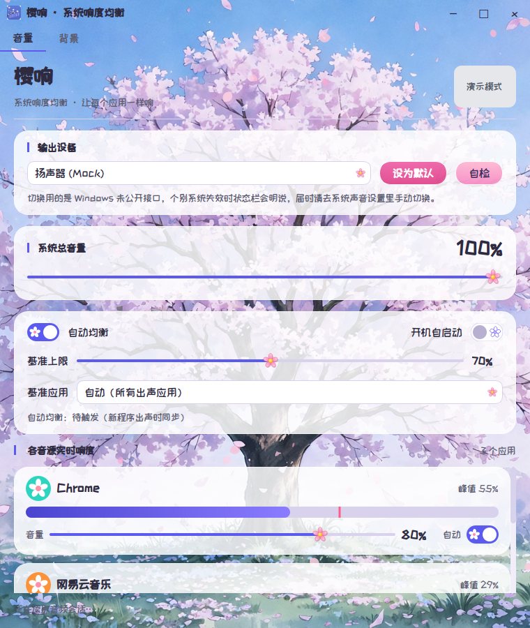
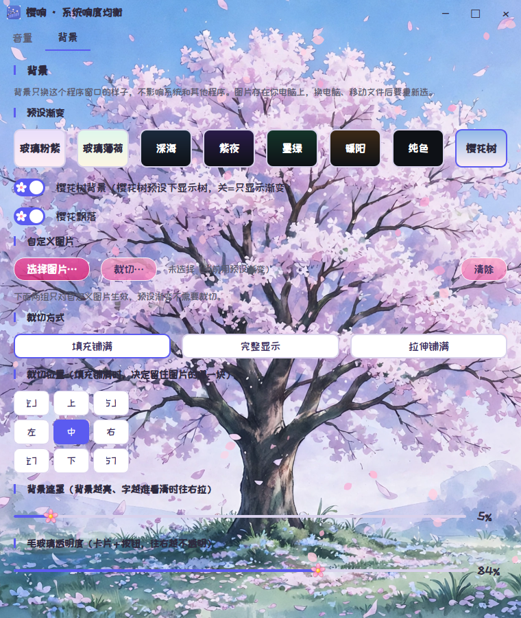

<p align="center">
  <br>
  <strong>樱响 SakuraSound</strong><br>
  让不同应用的声音听起来一样响，不用再来回摸音量键。
</p>

<p align="center">
  <a href="https://github.com/MingKing88/SakuraSound/releases"></a>
  <a href="LICENSE"></a>
  
  
</p>

<p align="center">
  <a href="https://github.com/MingKing88/SakuraSound/releases"><strong>下载最新版 ↗</strong></a> &nbsp; · &nbsp;
  <a href="#快速上手">快速上手</a> &nbsp; · &nbsp;
  <a href="#功能一览">功能一览</a> &nbsp; · &nbsp;
  <a href="https://github.com/MingKing88/SakuraSound/issues">反馈问题</a>
</p>

<p align="center">
  
  <br><sub>音量页：每个正在发声的应用一行实时条形，显示的是“实际听到的响度” = 会话峰值 × 系统总音量。</sub>
</p>

<p align="center">
  
  <br><sub>背景页：樱花树预设、樱花飘落开关与毛玻璃透明度。</sub>
</p>

樱响是一款 Windows 系统响度均衡工具：监听各应用的音频会话峰值，自动推拉混音器里的应用音量，让不同音源保持同一水平。它是“音量骑手”路线，只调会话音量，**不碰音频样本、不装音频驱动、不改系统音频链路**。均衡器已去掉，当前版本只做响度均衡。

## 交流与支持

遇到问题请通过 [GitHub Issues](https://github.com/MingKing88/SakuraSound/issues) 提交，附上系统、樱响版本、复现步骤与已脱敏的截图。欢迎分享使用经验与改进建议。

## 致谢

感谢以下开源项目与字体，没有它们就没有樱响。本节只致谢，不含任何赞助商：

- [pycaw](https://github.com/AndreMiras/pycaw) —— Windows Core Audio 会话接口
- [PySide6](https://www.qt.io/qt-for-python) —— 桌面界面
- 站酷快乐体（ZCOOL KuaiLe，OFL 开源字体）—— 内置圆体

第三方声明见 [THIRD_PARTY_NOTICES.md](THIRD_PARTY_NOTICES.md)。

## 功能一览

<table>
  <tr>
    <td width="50%" valign="top">
      <h3>🎚️ 自动均衡（相位制）</h3>
      拨开“自动均衡”开关立刻同步一次，随后每 5 秒同步一次、满 3 分钟后固定；关掉开关立刻停。新程序出声满 2 秒后同样进入该相位，相位进行中新程序加入则 3 分钟窗口从最新触发重算。改目标、重开某应用的自动，只单次同步，不进相位。
    </td>
    <td width="50%" valign="top">
      <h3>🎯 自动基准分层</h3>
      指定基准应用最优先；自动模式下按程序名字分层：浏览器 &gt; 其他 &gt; 流媒体，同一层里最响的赢，高层有出声就赢，不管低层多响。同步后真正拉平，不保留“音乐略响”的差距。
    </td>
  </tr>
  <tr>
    <td valign="top">
      <h3>🖐️ 手动调整优先</h3>
      一旦检测到你手动改了某个应用的音量（系统音量混合器、键盘音量键、别的软件都算），均衡器会立刻暂停对该应用的自动均衡，直到你重新勾上——永远不会跟你的手打架。
    </td>
    <td valign="top">
      <h3>🔊 跟随系统总音量</h3>
      均衡器只管应用之间的相对平衡，绝对响度永远由系统总音量说了算。总音量一调，均衡后的整体响度就跟着动，均衡器绝不会反向补偿。
    </td>
  </tr>
  <tr>
    <td valign="top">
      <h3>🎧 显示并切换输出设备</h3>
      顶部下拉列出所有播放设备，选中后点“设为默认”即可切换。切换用的是 Windows 未公开的 IPolicyConfig 接口（开源工具的通用做法）；如果在你的系统上不可用，会提示你去系统声音设置里手动切换。
    </td>
    <td valign="top">
      <h3>🚀 开机自启动</h3>
      安装包默认写开机自启动（当前用户 Run 注册表项，不需要管理员权限）；应用里关掉开关即删掉该项，卸载时也会删掉。便携包不改注册表，需手动勾开关。
    </td>
  </tr>
  <tr>
    <td colspan="2" valign="top">
      <h3>🌸 浅色玻璃 + 樱花树背景</h3>
      整套浅色玻璃风：粉紫渐变底、半透明白圆角卡片。背景页有樱花树预设（冷色居中樱花树）与两个开关：“樱花树背景”（开 = 树预设下显示树，关 = 只显示渐变）、“樱花飘落”（开 = 飘落，关 = 无花瓣）。樱花树模式花瓣从树冠起落，自定义壁纸模式从顶部均匀落下。自定义壁纸可视化裁切后直接铺满整个窗口，不留黑边。
    </td>
  </tr>
</table>

## 快速上手

### 1. 下载安装包或便携包

前往 [GitHub Releases](https://github.com/MingKing88/SakuraSound/releases)，下载最新版：

| 你的设备 | 安装包 |
| --- | --- |
| Windows 10 / 11 | `SakuraSound-Setup-*.exe`（安装包，默认开机自启动） |
| Windows 10 / 11 | `SakuraSound-Portable-*.zip`（便携包，解压双击即用） |

安装包无需管理员权限，装到当前用户目录；装过旧版（VolRider）的话请先手动卸载旧版，避免多出一个安装位置。

### 2. 从源码运行

```bat
pip install -r requirements.txt
python qt_app.py
```

也可以双击 `run.bat`。网页版：双击 `run-web.bat`，或 `python web\server.py`，浏览器打开 http://127.0.0.1:8000。`python web\server.py --mock` 可在没有 Windows 音频环境的机器上模拟演示。

## 工作原理

- 会话峰值来自 Windows Core Audio 的 `IAudioMeterInformation`；应用音量来自 `ISimpleAudioVolume`；总音量来自 `IAudioEndpointVolume`。
- 均衡器每 100ms 轮询一次：用长时平均（10 个出声样本一块、最近 100 块，约 100 秒出声时间）对齐各应用平时响度，一次爆炸、一段静音带不偏平均；固定后若某应用相对固定基线偏离 ±3dB 持续约 3 秒，则重进相位。
- 所有音频 API 调用集中在轮询线程，避免 COM 跨线程问题；静音应用不参与、不被调、不拖基准，且有目标 60% 的基准下限。

## 局限（请先了解再用）

- 独占模式（WASAPI Exclusive）的应用会绕过会话音量，均衡器管不到。
- 这是“音量骑手”路线，不是真正的动态范围压缩：修不了同一个应用内部的忽大忽小（比如电影里悄悄话后突然爆炸），那需要虚拟声卡 / APO 路线，本项目不做。
- 设备切换依赖未公开接口，个别 Windows 版本可能失效，属已知 best-effort；程序内有自检按钮，可查看各角色的切换结果。
- 均衡器已去掉：2026-10-25 起 PEQ 代码已归档在 `archive/peq-2026-10-25.py`，以后版本再做也不迟。

## 常见问题

<details>
  <summary><strong>装完开机没有自动启动？</strong></summary>

  只有安装包默认写开机自启动，便携包不写。打开应用，确认“开机自启动”开关是开着的；关掉再打开一次会重写 Run 注册表项。任务管理器 → 启动应用里也应能看到 SakuraSound。
</details>

<details>
  <summary><strong>为什么音乐被拉下来跟游戏一样响了？</strong></summary>

  这是设计如此：自动基准分层里浏览器 &gt; 其他 &gt; 流媒体，同步后真正拉平，不保留“音乐略响”的差距。想让某个应用当基准，用音量页的基准应用下拉指定它。
</details>

<details>
  <summary><strong>手动调了音量，怎么又被拉回去了？</strong></summary>

  手动改音量后该应用的“自动”勾应同步取消，不再被自动均衡。如果还被拉动，请在 Issues 里附上应用名与操作步骤。
</details>

## 一起把樱响做得更好

欢迎修复问题、完善文档，或分享你的使用建议。贡献方式见 [CONTRIBUTING.md](CONTRIBUTING.md)。

---

<p align="center">
  <strong>樱响 SakuraSound</strong> · 让不同应用的声音听起来一样响。<br>
  <sub>Copyright © 2026 YearnRiver · <a href="LICENSE">MIT</a></sub>
</p>
